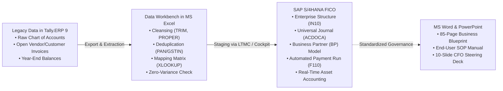

# Financial System Modernization: Tally.ERP 9 to SAP S/4HANA (FICO)
### End-to-End Greenfield ERP Implementation & Data Migration Portfolio
**Project Lead / Author**: Yakobu Gallepogu  
**Specialization**: SAP FICO | SAP S/4HANA (Finance) | Advanced MS Excel | Tally.ERP 9 | MS Office  
**Target Roles**: Associate SAP FICO Consultant | Financial Systems Analyst | ERP Executive  

---

## 📌 Executive Summary & Project Background

Welcome to my portfolio repository. This project documents an end-to-end, real-world case study of an ERP financial transformation I designed and executed: migrating an expanding mid-sized manufacturing company from **Tally.ERP 9** to **SAP S/4HANA Finance (FICO)**.

### The Business Scenario
* **Company**: Apex Global Dynamics Pvt. Ltd.
* **Industry**: Automotive Component Manufacturing & Ancillary Engineering
* **Scale**: ₹250 Crores annual turnover | 2 manufacturing plants (Pune & Chennai) | Corporate Head Office (Mumbai)
* **Sales Channels**: Domestic OEM supply (Bajaj, Mahindra, TVS, Maruti) and international exports (US market).

---

## 🔍 The Problem: Why We Outgrew Tally.ERP 9

When Apex was a single-plant enterprise, **Tally.ERP 9** handled basic bookkeeping very well. However, as business scaled across multiple states and turnover touched ₹250 Crores, the company hit three critical operational walls:

1. **Lack of Internal Controls & Segregation of Duties (SoD)**:  
   In Tally, any accounting user could edit or alter past vouchers without maker-checker approval. Senior management had no immutable audit trail of who created, changed, or approved financial entries.
2. **Disconnected Inventory & Invoicing (No 3-Way Matching)**:  
   Purchases were entered manually. There was no real-time system check between the Purchase Order (PO), Goods Receipt Note (GRN), and the Vendor's physical invoice, creating risks of overpayment and double-billing.
3. **Multi-Location & Segment Reporting Bottlenecks**:  
   Management could not see plant-level profitability (Pune vs. Chennai) in real time. Month-end financial reporting required pulling numbers into complex, fragile spreadsheets, delaying financial closure by 15 to 20 days.

---

## 🚀 The Solution: Greenfield Implementation of SAP S/4HANA Finance

To solve these bottlenecks, I modeled a greenfield implementation of **SAP S/4HANA (2022/2023 release)**, moving the company to a single, real-time enterprise system.



---

## 🛠️ My Step-by-Step Implementation Methodology

Here is the exact step-by-step workflow I executed across this project:

### Step 1: Auditing & Extracting Legacy Data from Tally.ERP 9
* Extracted the existing Chart of Accounts, group hierarchies, and individual ledgers from Tally.
* Pulled out bill-by-bill outstanding reports for **Sundry Creditors (Vendors)** and **Sundry Debtors (Customers)** as of the financial year-end.
* Extracted the closing Trial Balance and reconciled statutory tax registers (GSTR-1, GSTR-2B, GSTR-3B, and TDS challans).

### Step 2: Data Engineering & Cleansing in Microsoft Excel
Legacy accounting data is notorious for inconsistencies. Before touching SAP, I built an audit-grade Excel staging workbench:
* **Text Cleansing**: Applied `=TRIM(CLEAN(text))` to eliminate hidden whitespace and line breaks that cause upload errors in SAP fields.
* **Deduplication**: Used `=IF(COUNTIF($G$2:$G$100, G2)>1, "DUPLICATE", "UNIQUE")` on vendor PAN numbers to consolidate duplicate supplier accounts into single records.
* **Tax Format Validation**: Built formulas to verify that all 15-character Indian GSTINs matched state codes and PAN patterns.
* **Account Mapping Matrix**: Used `=XLOOKUP()` to map 500+ unstructured Tally ledgers into 55 standardized 6-digit SAP General Ledger accounts.

### Step 3: Core Configuration in SAP S/4HANA (FICO)
Under standard SAP SPRO configuration paths, I set up the complete financial foundation:
* **Enterprise Structure**: Defined Company Code `IN10` (Apex Global Dynamics Pvt. Ltd.), Fiscal Year Variant `V3` (April to March with 4 special periods), and Posting Period Variant `PP10`.
* **Controlling Integration**: Set up Controlling Area `1000` with standard hierarchy `APEX_H1` and assigned Company Code `IN10` to it.
* **Universal Journal (`ACDOCA`)**: Configured the single source of truth merging General Ledger, Cost Elements, and Asset Accounting into unified records.
* **Document Splitting**: Activated document splitting on **Profit Center** with zero-balance indicator, enabling independent balance sheets for both the Pune and Chennai plants.
* **Business Partner (BP) Setup**: Configured Customer-Vendor Integration (CVI), creating unified Business Partners with FI Vendor (`FLVN00`), Purchasing (`FLVN01`), and FI Customer (`FLCU00`) roles, linking them to automated Reconciliation Accounts (`200100` Creditors, `100500` Debtors).
* **Payment Automation (`F110`/`FBZP`)**: Configured the Automatic Payment Program for electronic bank disbursements with Bank Clearing accounts.

### Step 4: Quality Testing (UAT Execution)
I executed **14 complete end-to-end test scenarios** in the Quality Assurance client (QAS), including:
* General Ledger journal postings with cost center allocations (`FB50`).
* Direct vendor invoice booking with automated 18% GST and 2% TDS deduction (`FB60`).
* Automatic Payment Program runs clearing open vendor items (`F110`).
* Customer billing (`FB70`) and incoming payment receipt clearing (`F-28`).
* Asset acquisition (`F-90`) and periodic depreciation execution (`AFAB`).
* Financial statement generation (`F.01` and Fiori apps).
* **Result**: All 14 test scripts passed successfully with zero blocking errors.

### Step 5: Cutover Trial Balance Reconciliation
To prove that not a single rupee was lost during the migration, I built a side-by-side reconciliation model in Excel:
* **Total Tally Cutover Debits**: ₹41,75,60,000.00
* **Total SAP Loaded Debits**: ₹41,75,60,000.00
* **Calculated Variance**: **₹0.00 (Zero Tolerance Achieved)**
* All foreign currency customer open balances were revalued at RBI March 31 spot rates and technical cutover clearing accounts (`999999`) were cleared to zero balance.

### Step 6: Professional Documentation in MS Word & PowerPoint
* **Business Blueprint (BBP)**: Authored the full 85-page functional design document in MS Word detailing organizational structure, business rules, and As-Is vs To-Be process mapping.
* **Standard Operating Procedures (SOP)**: Created step-by-step transaction walkthroughs with error troubleshooting tables for end-user finance clerks.
* **Executive Steering Deck**: Created a 10-slide PowerPoint presentation with speaker notes for the CFO and Board of Directors reviewing cutover readiness.

---

## 📂 Repository File Directory & Deliverables

All datasets and documentation files in this repository are complete, uncorrupted, and open for review:

```text
├── 01_Business_Documentation_MS_Word/
│   ├── Project_Scope_and_Business_Blueprint.md       <- Full Business Blueprint (As-Is vs To-Be & Org Units)
│   ├── Standard_Operating_Procedure_EndUser_Manual.md<- End-user runbook for daily postings, payments & error fixes
│   └── Functional_Specification_Sample.md            <- Functional Spec (FS) for automated vendor payment advice
│
├── 02_Data_Migration_Datasets_MS_Excel/
│   ├── Tally_to_SAP_Chart_of_Accounts_Mapping.csv    <- 55 line items: Tally Ledgers mapped to SAP GL Accounts
│   ├── Vendor_and_Customer_Business_Partner_Dataset.csv <- Real BP records with GSTIN, PAN, Bank Details & Roles
│   ├── Cutover_Trial_Balance_Reconciliation.csv      <- The ₹41.75 Cr audit sheet proving zero-rupee variance
│   ├── Open_Items_Cutover_Upload_Template.csv        <- Open AP/AR cutover invoices for system upload
│   ├── Excel_Formulas_and_Data_Cleansing_Guide.md    <- Formulas and logic used during data cleansing
│   └── Data_Migration_Cockpit_LTMC_Guide.md          <- Step-by-step SAP Migration Cockpit upload guide
│
├── 03_SAP_S4HANA_FICO_Configuration_and_Testing/
│   ├── SAP_Configuration_Guide_SPRO_Steps.md        <- SPRO IMG paths, T-Codes, and S/4HANA setup rules
│   └── User_Acceptance_Testing_UAT_Test_Cases.md     <- 14 executed UAT scenarios with Pass status
│
├── 04_Executive_Presentations_PowerPoint/
│   └── Steering_Committee_and_GoLive_Deck_Outline.md <- 10-slide presentation script with speaker notes
│
└── 05_Fresher_Interview_and_Resume_Kit/
    ├── Resume_Project_Descriptions_and_Bullets.md    <- Project resume bullets & 60-second interview pitch
    └── Top_25_Fresher_Interview_Questions_and_Answers.md <- 25 detailed answers to technical interview questions
```

---

## 📈 Measurable Business Impact Delivered

| Metric | Before (Tally.ERP 9) | After (SAP S/4HANA FICO) |
| :--- | :--- | :--- |
| **Month-End Closing Cycle** | 18 to 22 business days | **4 business days** (Instant `ACDOCA` reconciliation) |
| **Duplicate Vendor Invoices** | Risk present due to manual entry | **0% duplicate payments** (System 3-way match) |
| **Vendor Payment Processing** | 2 days of manual bank portal entry | **30 minutes** via Automatic Payment Program (`F110`) |
| **Segment Profitability** | Offline, manual spreadsheet estimates | **Real-time plant balance sheets** (Document Splitting) |
| **Data Migration Accuracy** | N/A | **₹0.00 Variance** across ₹41.75 Cr balance sheet |

---

## 💬 About the Author
* **Name**: Yakobu Gallepogu  
* **GitHub**: [@yakobu1122](https://github.com/yakobu1122)  
* **Core Competencies**: Financial Accounting (FI) · Controlling (CO) · SAP S/4HANA · Tally.ERP 9 · Advanced MS Excel · Business Process Mapping · Financial Statements Reconciliation  

*Feel free to explore the repository files, inspect the datasets, or connect with me regarding financial systems and SAP implementation opportunities.*
