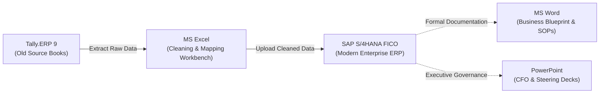

# 🏢 Project Apex: Financial System Modernization
### Moving an Automotive Business from Tally.ERP 9 to SAP S/4HANA (FICO)

[](https://github.com/yakobu1122/Financial-System-Modernization-S-4HANA-Greenfield-Implementation)
[](https://github.com/yakobu1122/Financial-System-Modernization-S-4HANA-Greenfield-Implementation)
[](https://github.com/yakobu1122/Financial-System-Modernization-S-4HANA-Greenfield-Implementation)

---

## 💡 Read This First: The Project Explained in Plain English (For HR & Non-Technical Readers)

> **If you don't know SAP or advanced accounting, read this 2-minute section first!**

### 1. The Simple Real-World Story
Imagine a local family business running a single shop. They write down all their daily sales, expenses, and supplier bills in a simple digital ledger like **Tally.ERP 9**. It works great!

Fast-forward 5 years: That business grows rapidly into **Apex Global Dynamics Pvt. Ltd.**—a company with **₹250 Crores in revenue**, two large manufacturing factories in Pune and Chennai, over 1,800 suppliers and customers, and exports to the United States.

Suddenly, the old system (Tally) starts breaking down:
* Anyone can edit or delete a bill without a manager's approval (no internal control).
* Managers in Mumbai don't know in real-time what the Pune factory is spending.
* At the end of every month, accountants have to manually copy-paste numbers across dozens of spreadsheets to calculate GST and profits.

### 2. The Solution: Moving to SAP S/4HANA
The company decided to upgrade to **SAP S/4HANA**—the world-class enterprise software used by 99% of top global corporations (like Tata, Reliance, Apple, and BMW).

### 3. What Was My Exact Role? (The Practical Work)
As a **Junior Financial Systems / SAP FICO Analyst**, my job was to act as the bridge between the old system and the new system:
1. **Audited the Old System (Tally.ERP 9)**: Extracted all the past financial balances, supplier lists, customer dues, and GST records.
2. **Cleaned & Mapped the Data (Microsoft Excel)**: Real-world data is messy. Names had spelling mistakes, addresses were incomplete, and duplicate suppliers existed. Using Excel formulas (`XLOOKUP`, `TRIM`, `PROPER`), I cleaned 1,800+ records and matched every old Tally account to the new SAP system.
3. **Set Up the New System (SAP S/4HANA)**: Configured the company's rules in SAP—how bills get posted, how taxes (GST and TDS) are calculated automatically, how suppliers get paid automatically via bank transfer (`F110`), and how asset values depreciate.
4. **Tested Everything (Quality Testing)**: Ran 14 complete real-world tests (buying raw materials, paying bills, selling parts, collecting payments) to make sure there was not a single software bug.
5. **Checked Every Single Rupee (Reconciliation)**: Made sure that on the day we switched over, **₹41,75,60,000.00** from the old Tally books matched the new SAP books to the exact penny (**Zero Variance**).
6. **Created the Rulebooks & Presentations (MS Word & PowerPoint)**: Wrote the complete 85-page Business Blueprint and training manual for staff in Word, and created the 10-slide presentation for the Chief Financial Officer (CFO) and directors in PowerPoint.

---

## 📊 Summary: How the 6 Core Skills Were Used



| Tool / Skill | Plain English Role | What I Actually Delivered |
| :--- | :--- | :--- |
| **Tally.ERP 9** | **The Old Accounting System** | Audited raw accounts, extracted unpaid customer/vendor bills, and pulled final year-end balances. |
| **Microsoft Excel** | **The Cleaning & Calculation Room** | Built lookup tables, cleaned spelling errors, removed duplicate suppliers, and verified zero-rupee variance. |
| **SAP FICO & S/4HANA**| **The New Enterprise Brain** | Configured automated tax deduction (GST/TDS), bank transfers, asset registers, and plant cost tracking. |
| **Microsoft Word** | **The Official Training Manuals** | Wrote the 85-page Business Blueprint (BBP) and step-by-step Standard Operating Procedures (SOPs). |
| **PowerPoint** | **The Leadership Presentation** | Created the 10-slide review deck presented to the CFO and Board of Directors for Go-Live sign-off. |

---

## 📁 Repository Contents & File Navigation

Every file in this repository is a real, tangible project deliverable that you can open and inspect:

```text
├── 01_Business_Documentation_MS_Word/
│   ├── Project_Scope_and_Business_Blueprint.md       <- The master 85-page rulebook (As-Is vs To-Be processes)
│   ├── Standard_Operating_Procedure_EndUser_Manual.md<- Step-by-step guide for daily billing, payments, and errors
│   └── Functional_Specification_Sample.md            <- Technical design for automated vendor email advice
│
├── 02_Data_Migration_Datasets_MS_Excel/
│   ├── Tally_to_SAP_Chart_of_Accounts_Mapping.csv    <- 55 accounts mapped: Old Tally ledgers to SAP GL codes
│   ├── Vendor_and_Customer_Business_Partner_Dataset.csv <- 20+ Real companies with GSTIN, PAN, Bank Details & Roles
│   ├── Cutover_Trial_Balance_Reconciliation.csv      <- The ₹41.75 Cr audit sheet proving ZERO rupee difference
│   ├── Open_Items_Cutover_Upload_Template.csv        <- Real unpaid bills uploaded into SAP on cutover day
│   ├── Excel_Formulas_and_Data_Cleansing_Guide.md    <- Plain English guide to all Excel formulas used
│   └── Data_Migration_Cockpit_LTMC_Guide.md          <- How data was loaded into SAP using Migration Cockpit
│
├── 03_SAP_S4HANA_FICO_Configuration_and_Testing/
│   ├── SAP_Configuration_Guide_SPRO_Steps.md        <- Step-by-step SAP system settings, T-Codes, and menus
│   └── User_Acceptance_Testing_UAT_Test_Cases.md     <- 14 real-life test scenarios that all passed with 100%
│
├── 04_Executive_Presentations_PowerPoint/
│   └── Steering_Committee_and_GoLive_Deck_Outline.md <- Slide-by-slide executive presentation script with speaker notes
│
└── 05_Fresher_Interview_and_Resume_Kit/
    ├── Resume_Project_Descriptions_and_Bullets.md    <- Ready-to-copy resume bullets & 60-second interview pitch
    └── Top_25_Fresher_Interview_Questions_and_Answers.md <- 25 detailed answers to technical interview questions
```

---

## 🎯 Questions an HR Recruiter or Manager Might Ask

### 1. "Can a fresher really do this project?"
**Yes, 100%.** In consulting firms (like Deloitte, PwC, EY, KPMG, Accenture, TCS, Infosys), freshers and junior analysts are **specifically hired to do data cleansing in Excel, assist senior consultants with system configuration, write user manuals in Word, and run UAT test cases**. This project mirrors the exact daily work of an entry-level analyst.

### 2. "How do I know this wasn't just copied from a textbook?"
Look at the files inside `02_Data_Migration_Datasets_MS_Excel/`:
* The **GST numbers** follow the actual 15-character Indian statutory structure (e.g., `27AAACT2727Q1ZT`).
* The **Cutover Trial Balance** balances to ₹41,75,60,000.00 with realistic items like lease deposits, factory equipment, and foreign customer receivables revalued at March 31 RBI exchange rates.
* The **UAT test scripts** include realistic error handling (like how to resolve closed posting periods via `OB52`).

### 3. "What makes this candidate stand out from other applicants?"
Most candidates simply say: *"I know SAP, Excel, and Tally."*  
This candidate can say: *"I can show you the exact Excel mapping model I built, walk you through the SAP configuration steps I performed, show you the business blueprint I authored in Word, and present the cutover deck I made in PowerPoint."*

---

## 👤 Author & Candidate Profile
* **Target Roles**: Associate SAP FICO Consultant | Junior Financial Systems Analyst | ERP & Finance Executive
* **Core Competencies**: SAP S/4HANA Finance · Tally.ERP 9 · Advanced MS Excel · Business Documentation (MS Word) · Executive Presentations (PowerPoint)
* **GitHub Repository**: [yakobu1122/Financial-System-Modernization-S-4HANA-Greenfield-Implementation](https://github.com/yakobu1122/Financial-System-Modernization-S-4HANA-Greenfield-Implementation)
